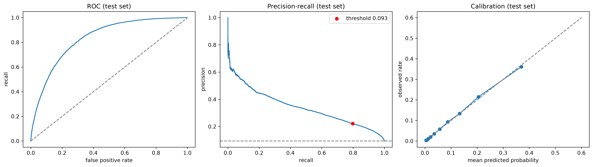
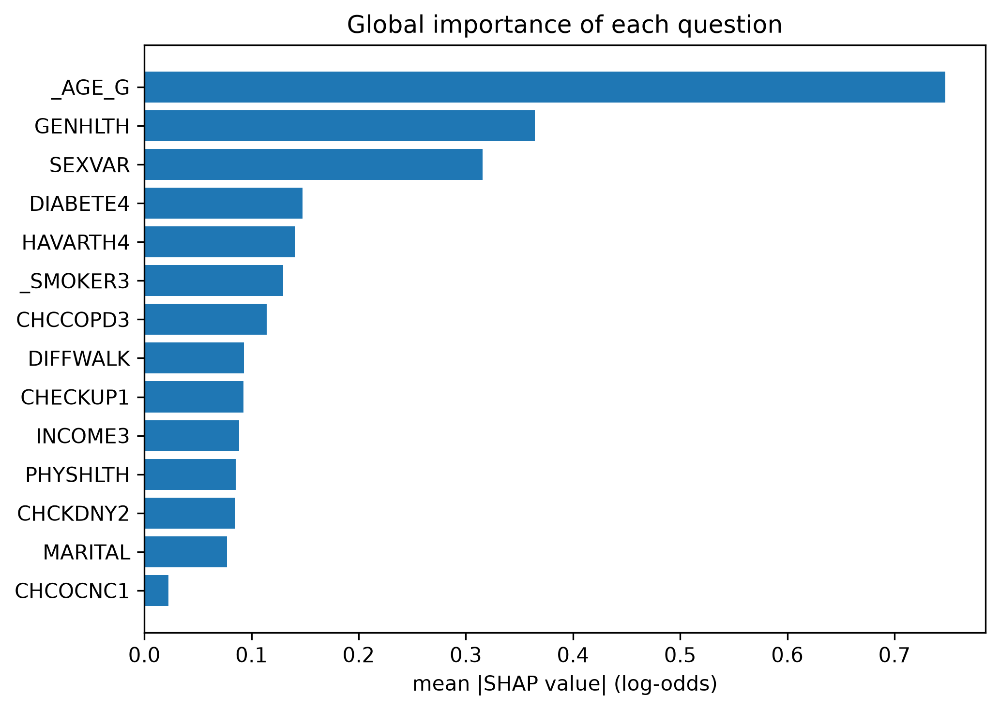
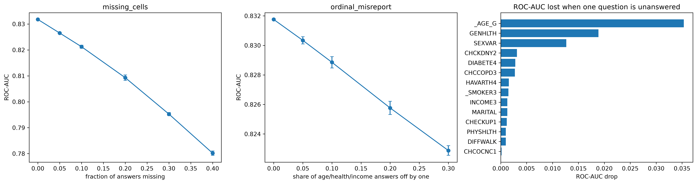
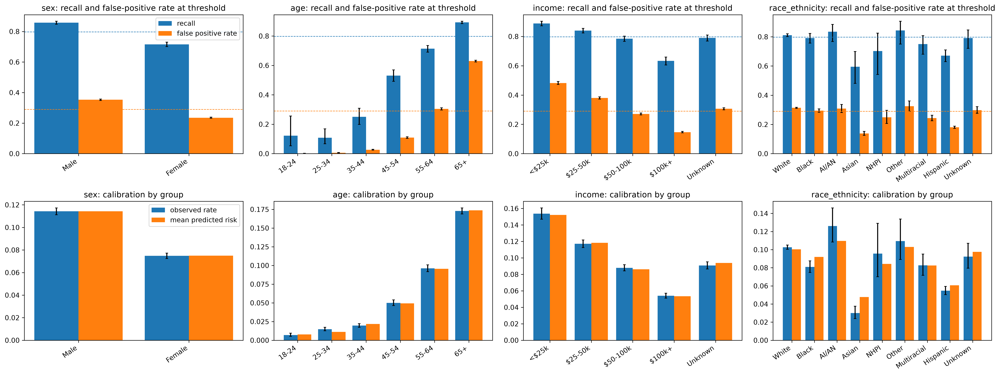

# CardioRisk: An Explainable, Robust ML Framework for Cardiovascular Disease Risk Prediction

An end-to-end machine learning system that estimates cardiovascular disease risk from the **2024 CDC BRFSS** population health survey (457,670 respondents). It benchmarks 6 classifiers and 2 ensemble strategies under leakage-safe cross-validation, tunes and calibrates the final model, audits it across subgroups, stress-tests it with missing and noisy inputs, explains it with SHAP, and ships it as a live interactive risk-screening demo.

**Live demo:** [_add your Streamlit link here after deployment_](https://cardioriskml.streamlit.app/)

> Built as a Fundamentals of ML Lab mini-project by Bhumika Anushka Yeggina, Ginjupalli Tamoghna Sri Ram and Karimireddy Likith Reddy, MIT Manipal. It estimates the likelihood of *self-reported* coronary heart disease or heart attack. It is an academic framework, **not** a medical device and **not** a diagnosis.

## Why this project

Most student heart-disease projects use the 303-row Cleveland dataset. This one uses a current, large-scale population survey (452,464 usable respondents, 9.4% reporting coronary heart disease or a heart attack) and goes beyond "compare six models": it adds a paired ablation study, class-imbalance analysis, calibration and threshold selection, a sealed test set with bootstrap intervals, robustness tests, a subgroup fairness audit, SHAP explanations, and a deployed app.

## Results

### Final model on the sealed test set

Tuned XGBoost (unweighted) on 14 survey questions. The test set (n = 90,493; 8,468 cases) was used once, after the model, features and decision threshold were fixed using training data only. Intervals are 95% bootstrap.

| Metric | Result |
|---|---|
| ROC-AUC | 0.832 (0.828 to 0.835) |
| PR-AUC | 0.341 (0.332 to 0.351); a random classifier scores 0.094 |
| Brier score | 0.0717 (a constant base-rate forecast scores 0.085) |
| Mean predicted vs observed risk | 0.0936 vs 0.0936 |
| Recall at the pre-fixed threshold (0.093) | 0.798 (0.788 to 0.805) |
| Specificity / precision | 0.710 / 0.221 |
| Share of people flagged | 33.7% (about 4.5 flagged people per true case) |

These matched the out-of-fold estimates made beforehand (ROC-AUC 0.830, PR-AUC 0.341, recall 0.80), so model selection did not overfit.



### Model comparison

Five-fold stratified cross-validation on the training data, 14 questions, tuned hyperparameters, no imbalance handling. The SVM and KNN cannot handle all 362k training rows, so every model uses the row count shown.

| Model | ROC-AUC | PR-AUC | Brier | Rows used |
|---|---|---|---|---|
| Logistic regression | 0.824 | 0.330 | 0.073 | 100k |
| K-nearest neighbours | 0.818 | 0.316 | 0.074 | 30k |
| SVM (RBF) | 0.654 (0.810 with class weights) | 0.251 (0.273) | n/a | 30k |
| Decision tree | 0.813 | 0.299 | 0.074 | 100k |
| Random Forest | 0.825 | 0.330 | 0.073 | 100k |
| XGBoost | 0.827 | 0.334 | 0.072 | 100k |

### Ensembles vs single models

Out-of-fold predictions on the full 362k-row training set, scored on identical row subsets.

| Model | ROC-AUC | PR-AUC | Brier |
|---|---|---|---|
| Logistic regression | 0.8269 | 0.3356 | 0.0722 |
| Random Forest | 0.8287 | 0.3384 | 0.0721 |
| XGBoost | 0.8303 | 0.3407 | 0.0718 |
| Voting (LR + XGB + RF) | 0.8304 | 0.3405 | 0.0718 |
| Voting (XGB + RF) | 0.8304 | 0.3412 | 0.0718 |
| Stacking (LR + XGB + RF) | 0.8306 | 0.3412 | 0.0718 |

Ensembles gained at most 0.0005 PR-AUC, so a single XGBoost was chosen.

### Choosing the decision threshold

Out-of-fold XGBoost predictions on the training set; the 80%-recall row is the fixed operating point.

| Goal | Threshold | Specificity | Precision | People flagged |
|---|---|---|---|---|
| Recall 70% | 0.129 | 0.790 | 0.256 | 25.6% |
| **Recall 80%** | **0.093** | **0.710** | **0.221** | **33.8%** |
| Recall 90% | 0.051 | 0.575 | 0.179 | 47.0% |

## Key findings

- **A performance plateau.** Logistic regression, Random Forest and XGBoost all reach ROC-AUC of about 0.83 and PR-AUC of about 0.34. Tuning helped little (only KNN gained clearly) and ensembles added nothing.
- **14 questions are enough.** From 29 candidates, seven selection methods and a paired ablation study chose 14 questions. Going from 29 to 15 questions cost about 0.002 ROC-AUC; a derived "chronic condition count" added nothing; employment status ranked 3rd by selection but removing it cost under 0.001.
- **Imbalance changes the cutoff, not the ranking.** Class weighting and undersampling left ROC-AUC unchanged but raised Brier score from about 0.073 to 0.11 to 0.18 (distorted probabilities). The final model is trained unweighted, and sensitivity is set through the threshold. Class weighting also revealed why the untuned SVM was weak (ROC-AUC 0.654 rising to 0.810).
- **Well calibrated.** Predicted risk matches observed risk overall and within sex, age and income groups.
- **Graceful under imperfect inputs.** ROC-AUC falls about 0.001 per percentage point of answers missing and barely moves when age, health or income answers are off by one category.
- **What drives predictions (SHAP).** Age, general health and sex account for 57% of the model's attribution.
- **Subgroup audit.** Calibration holds within sex, age and income, but one cutoff behaves very differently by age (recall about 11 to 12% under age 35 vs 89% at 65+) and by sex (72% for women vs 86% for men). Risk is slightly over-estimated for some racial and ethnic groups even though race is not a model input.





## Project structure

```
cardiorisk-ml/
├── app/
│   ├── streamlit_app.py            # the deployed demo
│   └── requirements.txt            # pinned versions for deployment
├── data/                           # not committed; created by the pipeline
│   ├── raw/
│   └── processed/
├── models/
│   └── final_xgb_pipeline.joblib   # final fitted pipeline
├── notebooks/                      # 15 analysis notebooks, run in order (see notebooks/README.md)
├── reports/
│   ├── figures/                    # all report figures
│   ├── tuning/                     # hyperparameter search results
│   └── *.csv / *.json              # result tables and decisions (final features, threshold, ...)
├── src/                            # reusable, tested pipeline code
│   ├── data_loader.py              # download + per-column cleaning
│   ├── preprocessing.py            # leak-safe pipeline, derived feature
│   ├── feature_selection.py        # 7 selection methods
│   ├── baseline.py  ablation.py  tuning.py  imbalance.py
│   ├── thresholds.py  ensembles.py  final_eval.py
│   └── robustness.py  fairness.py  explain.py
├── requirements.txt                # environment for the notebooks
├── PROJECT_GUIDE.md                # methodology and decision log
└── README.md
```

## Quickstart

```bash
git clone https://github.com/Bhumikayeggina/cardiorisk-ml.git
cd cardiorisk-ml
python -m venv venv
venv\Scripts\activate            # Windows (macOS/Linux: source venv/bin/activate)
pip install -r requirements.txt

# 1. Download and clean the data (about 64 MB, straight from the CDC)
python src/data_loader.py

# 2. Run notebooks 02 to 15 in order (see notebooks/README.md)

# 3. Launch the demo locally
streamlit run app/streamlit_app.py
```

The app only needs the committed model and the small files in `models/` and `reports/`, so step 3 works without re-running anything. The deployed app uses the pinned versions in `app/requirements.txt`, because a saved model only loads reliably with the library versions it was created with.

## Full build guide

See **[PROJECT_GUIDE.md](./PROJECT_GUIDE.md)** for the step-by-step methodology, the evidence behind each decision, and where each result comes from.

## Limitations

- The target is self-reported "ever told" heart disease or heart attack status from a single survey year, not a clinical diagnosis.
- Blood pressure and cholesterol are not in the 2024 public file, so the model cannot use them.
- At 9.4% prevalence and AUC 0.83, catching 80% of cases means flagging about a third of people; the tool suits screening and prioritisation, not diagnosis.
- Subgroup differences exist (see findings); the audit is descriptive, not a fairness guarantee.
- The robustness test removes answers completely at random; real non-response is not random.

## Tech stack

Python, pandas, NumPy, scikit-learn, XGBoost, imbalanced-learn, SHAP, Matplotlib, Streamlit, Jupyter, Git/GitHub.

## Disclaimer

This is an academic demonstration built on self-reported survey data. It is not a validated clinical tool and must not be used for medical decisions.
